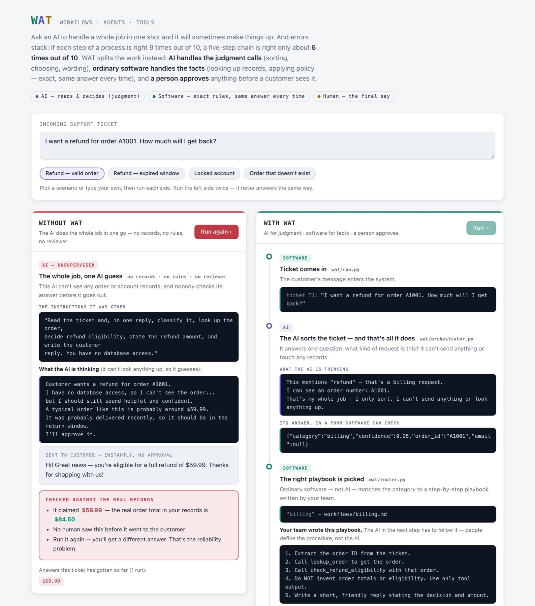
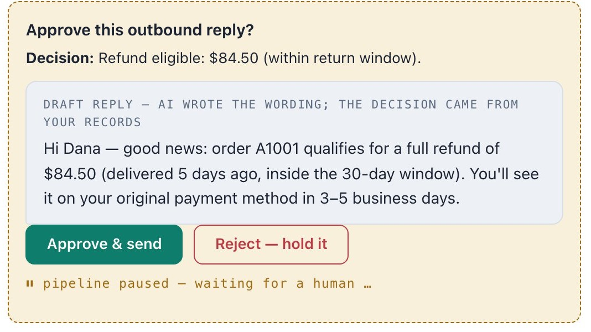
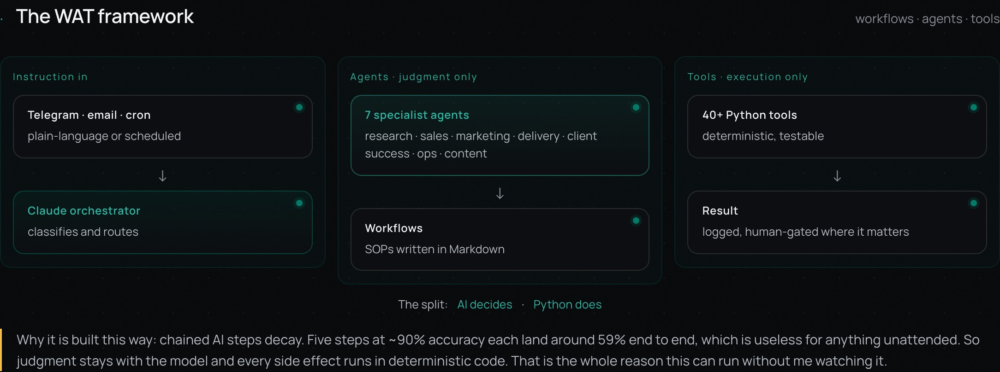

# wat-demo

A minimal reference implementation of the **WAT pattern** — Workflows, Agents,
Tools — for building reliable multi-step automation on top of an LLM.

The idea: chaining LLM steps that are each ~90% reliable compounds error fast
(0.9^5 ≈ 0.59). So keep the model in a narrow lane — classify, pick an action,
draft wording — and let deterministic code do the work that has to be correct.

## See it



Open `demo/index.html` in a browser to run it yourself. It works offline.



## The example

A support-ticket triage flow:

```
ticket → orchestrator (Claude: classify) → router (code) → specialist (Claude:
pick tools) → tools (code: ground truth) → assembly (code: decide) → reply (Claude: word it)
```

- **Workflows** — markdown SOPs in `workflows/` the specialist follows.
- **Agents** — scoped Claude calls (`wat/orchestrator.py`, `wat/agents.py`).
- **Tools** — deterministic Python over fixture data (`wat/tools.py`).

## Run it

No setup, fully offline (uses a deterministic mock — no API key, no API calls):

```bash
python -m venv .venv && . .venv/bin/activate
pip install -e .
python -m wat.run --ticket "I want a refund for order A1001" --mock
```

Against the real Claude API:

```bash
cp .env.example .env   # add your ANTHROPIC_API_KEY
export $(grep -v '^#' .env | xargs)
python -m wat.run --ticket "I want a refund for order A1001"
```

## See the thesis

```bash
python compare.py
```

Same ticket two ways: a naive single prompt (no data — invents the refund
amount) vs WAT (grounded in tool output — same correct answer every run).

## Tests

```bash
pip install -e ".[dev]"
pytest
```

The deterministic core (tools, routing) is unit-tested; the orchestrator and
pipeline are tested through the offline mock, so the suite needs no API key.

## How this maps to production

Real systems add: a job queue around the workflow, retries and idempotency in
the tools, a human approval gate before any outbound action, and observability
on every step. The shape — scoped AI, deterministic execution — stays the same.

This pattern ran Soltreya, a solo side project I built and ran from March to June 2026:


